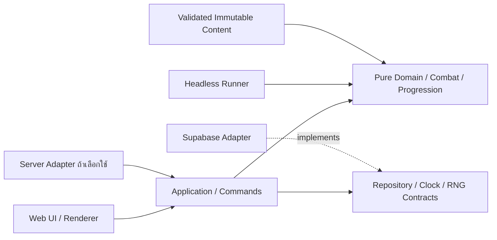

# ตรวจความพร้อมสถาปัตยกรรมและความเสี่ยงที่ต้องรื้อภายหลัง

วันที่: 19 ตุลาคม 2026 · ผล: **M0 design gate ผ่านแล้ว; หลักฐาน implementation ยังแยกตามงานเจ้าของ**

คำว่าtask/dependencyผ่านไม่ใช่ยืนยันว่าสถาปัตยกรรมทำงานจริง ตอนauditครั้งแรก47งานอยู่todo; ปัจจุบันM0ครบ15งานผ่านdesigngateตาม [overview](overview.md) และ [gate report](evidence/task-014-review.json) ข้อความช่องว่างในตารางแรกคงไว้เป็นประวัติ ใช้closureด้านท้ายเป็นสถานะdesignล่าสุด

## หลักฐานจาก workspace

- มี design proposals เรื่อง cloud, simulation, composition และ math พร้อม task ที่รับผิดชอบ
- M0มีprogression/combat/composition/126skills/60gear/18cards/80stages/UX/architecture/16schemasและ201ACmatrix ตรวจ749checks+8gatechecksผ่าน ยังไม่มีผลทดสอบengine/SQL/browser ณเวลาgate
- ผลส่งมอบ [UI](design/10-ui-and-player-flows.md), [architecture](design/11-technical-architecture.md) และ [acceptance matrix](acceptance-matrix.md) มีจริงและผ่านM0แล้ว
- [asset lab](../preview/asset-lab/app.mjs) เป็นเครื่องมือดูภาพ มี DOM/เวลา browser และ [renderer](../preview/asset-lab/renderer.mjs) มีการสร้าง canvas ใช้เป็นฐาน renderer ได้ แต่ไม่ใช่หลักฐานว่า combat engine แบบ headless เสร็จหรือ import แยกได้แล้ว
- Q-017/Q-022 เป็นadditive/no capและindependent expiryทั้งคนเดิม/ต่างคน; baseline15/16ลงสูตรและtimingแล้ว รอruntime

## สัญญาที่ต้องปิดก่อน TASK-014 ผ่าน

| ID | ช่องว่างที่พบ | ถ้าไม่ปิดจะกระทบ | เจ้าของ M0 | หลักฐานที่ต้องได้ |
| --- | --- | --- | --- | --- |
| A-01 | ขอบเขต import/module และที่อยู่ของกติกายังไม่ล็อก | สูตรหลุดไปอยู่ UI/DB/renderer และ simulator ใช้คนละชุด | TASK-013/047 | dependency diagram, ownership และ public interfaces ที่ไม่มีวงย้อน |
| A-02 | แหล่งข้อมูลหลัก/ชนิด command/การยืนยัน save ยังเป็นแนวทางกว้าง | wallet/inventory/checkpoint กับ DB แข่งกันเป็นค่าหลัก; retry อาจใช้ทรัพยากรซ้ำ | TASK-013 | authority matrix, command/receipt payload, revision/idempotency/ความหมายของ pending/committed/acknowledged |
| A-03 | เลือกฐาน Vercel TypeScript แล้ว แต่ command/RPC sequence กับ version/retry ของแต่ละ operation ยังไม่ครบ | กฎ TS กับ SQL แยกสำเนาแล้วบาลานซ์เปลี่ยนไม่ตรงกัน | TASK-013 | execution contract ต่อ operation; RPC commit แบบ atomic ไม่สร้างสูตรบาลานซ์อีกชุด |
| A-04 | มี schema/content version แต่ rules/RNG/compatibility ยังไม่ครบ | replay/ไฟต์ค้าง/เซฟเก่าได้ผลเปลี่ยนหลัง deploy หรือ item/skill ID หาย | TASK-002/013/047 | schema/content/rules compatibility matrix, hash/ID policy, migrate/reject/backup ตามกรณี |
| A-05 | reload/เน็ตขาด/พักแท็บ/ข้ามวันระหว่างไฟต์ยังไม่มีตารางครบทุกโหมด | รับ AFK ซ้ำกับไฟต์, daily attempts หรือกล่องคลาดเคลื่อน, boss progress เกิดขณะปิดเกม | TASK-001/011/013 | interruption matrix ของ Story/Tower/daily/farm และขอบเขต durable กับ transient state |
| A-06 | TASK-001 เลือก actual-paid ledger พร้อมเคส cost v1→v2 แล้ว; migration/transaction contracts ยังไม่ครบ | respec/สลับคลาส/Awaken คืนเกินทุนหรือทำทรัพยากรหายหลัง patch | TASK-001/010/013 | นำ policy/fixtures ที่ผ่านแล้วไปลง persistence/migration และพิสูจน์ runtime |
| A-07 | build variant/actor constraints ของระบบอนาคตยังไม่เป็น contract ครบ | Awaken/Artifact แก้ shared definition, Pet/Plant ชนข้อจำกัดทีมสี่คน, Hi-class ผูกกับ level ผิด | TASK-001/013/047 | ลำดับสร้าง build, stable IDs, actor model, party validation และตัวอย่างส่วนขยาย |
| A-08 | การตรวจสถาปัตยกรรมมีแต่แผน ยังไม่มีการบังคับ/ผลรัน | โค้ดใหม่ละเมิด boundary โดยไม่ถูกพบ หรือยืนยัน compatibility จากการอ่านอย่างเดียว | TASK-013/014 | ระบุ check/fixture/เจ้าของการพิสูจน์ใน M1/M2/M4; M0 ไม่อ้างผลรันที่ยังไม่มี |

ตารางนี้เป็นงานที่ต้องปิดใน task เดิม ไม่เพิ่ม framework/ระบบอนาคตขึ้นมาเพื่อผ่าน audit และไม่ถือว่าการเขียนข้อกำหนดในตารางทำให้ช่องว่างนั้นปิดแล้ว

ความคืบหน้ารอบ D-036: [extension contracts](design/14-extension-contracts.md) ลงรายละเอียด ordered effects/per-target outcomes/typed handlers/immutable variants/module paths และเลือกฐาน account commands บน Vercel TypeScript + Supabase atomic commit พร้อม [ตัวอย่างประกอบ](examples/composition-contract.json) แล้ว เป็นหลักฐานการปรับแบบบางส่วนของ A-01/A-02/A-03/A-07 ไม่ใช่ closure ครบ; schema/catalog/sequence/migration/quality budgets และผลรันยังต้องทำตาม M0/งานพิสูจน์เดิม

## ขอบเขตโมดูลที่เสนอให้ M0 ตรวจเลือก

- Core รับข้อมูล/เวลาเกม/RNG ที่ฉีดเข้าไป คืน state/events/คำสั่งที่มีชนิดชัดเจน ไม่เรียก DOM/Canvas/network/เวลาเครื่องหรือ global randomness
- UI/renderer วาดจาก view/events และส่ง application command ไม่เขียน wallet/ฐานข้อมูลเอง
- Content แยก definition ที่ immutable จาก character/build/battle instances สูตรพิเศษอ้าง registry ID และต้องผ่าน pipeline กลาง/metrics
- กลไกบัญชี เช่น อัป/ผสม/กาชา/รับ AFK เรียก domain operation ผ่าน boundary ที่เลือก แล้ว persist พร้อม revision/receipt ไม่แก้ state คนละทางตามแต่หน้าจอ
- แยก media resolver/asset pack ออกจาก combat rules; game content ใช้ asset IDs ไม่ฝัง ACT/STR/media ลง battle snapshot
- ใช้เฉพาะ primitive/extension ที่สกิลรุ่นแรกต้องการ ไม่สร้าง plugin framework หรือภาษา script แบบไม่มีขอบเขต

นี่เป็นแนวทางเสนอ ไม่ใช่ module graph ที่ถูก enforce ใน source แล้ว TASK-013 ต้องกำหนด path/import rules จริงให้ TASK-015 ตรวจได้

## การคำนวณฝั่ง server กับฐานข้อมูล

ต้องเลือกผู้คำนวณต่อ operation ให้ชัด กรณีเลือกคำนวณฝั่ง server แนะนำให้ใช้ pure TypeScript domain ร่วมกับ browser/runner และให้ DB/RPC รับผิดชอบ atomic persistence/revision/receipts หากเลือกคำนวณที่ client สำหรับเกมส่วนตัว ต้องระบุ trust boundary/commit protocol ชัดเช่นกัน ไม่ให้บาง flow เขียนสูตรซ้ำใน SQL โดยไม่มีเจ้าของ

รอบ audit เดิมตรวจทางเลือก [Vercel Functions ด้วย Node.js/TypeScript](https://vercel.com/docs/functions/runtimes/node-js) กับ [Supabase Edge Functions](https://supabase.com/docs/guides/functions) และ [database functions](https://supabase.com/docs/guides/database/functions) ต่อมารอบ D-036 เลือกฐาน Vercel API รัน TypeScript domain และ DB ทำ atomic commit ตาม design/14; TASK-013 ยังต้องตรวจและลงสัญญาให้ครบ ไม่ใช่บริการที่ติดตั้งแล้ว

ต้องมีวิธีรัน adapter/API เพื่อทดสอบบนเครื่องหรือ environment ทดสอบตั้งแต่ TASK-015/021/022 ไม่สร้าง dependency ย้อนว่าต้องรอ public Preview TASK-043 ก่อนจึงทดสอบเซฟหลักได้

## สัญญา save และ migration ที่ต้องเขียนให้เป็นรูปธรรม

- เลือกค่าหลักของ roster/wallet/inventory/progression เพียงชุดเดียว แต่ละสำเนาใน UI/checkpoint ระบุ revision ที่อ้าง ไม่ตั้ง wallet อีกตารางกับ wallet ใน JSON ให้ต่างฝ่ายต่างแก้
- คำขอเปลี่ยนข้อมูลต้องมี ID/expected revision/type/parameters และกติกากรณี ID เดิมแต่ payload ต่างกัน; ผลรับสำเร็จต้อง replay receipt ได้เมื่อ response หาย
- Autosave/checkpoint/import ต้องไม่เขียนทับ server-owned claim cursor/receipts หรือย้อน wallet หลังธุรกรรมสำเร็จ
- schema version อธิบายโครงข้อมูล, content version/hash อธิบาย definitions, rules version อธิบายสูตร/ลำดับเหตุการณ์/RNG ที่ผลรันพึ่งอยู่ กำหนดกรณีเวอร์ชันเก่า/ใหม่เกินรองรับให้ชัด
- เลือกกติกา reward rate snapshot เมื่อ balance patch ระหว่าง AFK และวิธีจัดข้อมูลเก่าที่ใช้ skill/item/status ID ถูกเปลี่ยนหรือลบ
- ค่า refund ต้องผูกกับต้นทุนที่จ่ายจริงหรือ policy ที่เลือกอย่างชัดเจน ไม่เผลอใช้ราคาใหม่ย้อนหลังจนวนอัป/รีเซ็ตแล้วทรัพยากรเพิ่ม
- แยก durable account state จาก transient battle state หากจะ resume ไฟต์ต้องระบุ clock/RNG/pending event/cast cancellation/status expiry/version ที่ต้องเก็บ หากไม่ resume ต้องระบุผลต่อ attempt/reward/HP ตามโหมด

## ตรวจการต่อยอดโดยไม่ต้องพัฒนาทุกระบบล่วงหน้า

| การเปลี่ยน | หลักฐานระดับสัญญาก่อน coding | หลักฐานที่ทำจริงหลังมีแกน |
| --- | --- | --- |
| เพิ่มสกิล/สถานะ/การ์ด | data instance ผ่าน schema ใช้ primitive เดิม; เพิ่ม handler เฉพาะที่จำเป็น | core/runner รับผลเดียวกัน, metrics มี source และไม่มีสูตรหลุดเข้า UI |
| Awaken + Artifact | derive variant ด้วย stable skill/effect ID และลำดับ merge ชัด ไม่แก้ base/global state | fixture สองตัวละคร/สอง A-B variants ไม่ปนกัน |
| Hi-class/Class 3 | job lineage/promotion แยกจาก character level/cap และไม่มี auto stat growth ที่ผู้ใช้ยกเลิก | upgrade/migrate เซฟเดิมแล้ว level/skills/slot investment คงตาม policy |
| Plant/Pet | battle actor collection ยืดหยุ่น มี owner/source; กติกา main+NPC3 อยู่ที่ party validation | ทดสอบ actor ที่เพิ่ม/หมดอายุโดยไม่ทำ roster/cast queue ของคนอื่นเปลี่ยน |
| ปรับสูตรหรือราคา | version/compatibility/refund policy และ expected cases ก่อนหลัง | replay ใช้รุ่นเดิมได้หรือแจ้ง incompatible; migrate/refund ไม่สร้างของซ้ำ |
| เพิ่ม renderer/เปลี่ยน UI | core ports/import graph แยกจาก browser และ network | headless รันโดยไม่มี DOM/DB และผลตรง runtime |

## จุดตรวจที่ใช้ตัดสินความพร้อมจริง

1. **ก่อน coding:** TASK-014 ตรวจว่าทุก A-01–A-08 มี decision/contract/ตัวอย่าง input-output/ผู้รับผิดชอบการทดสอบครบ ไม่มีช่องว่างที่กระทบโมดูลหลักค้างไว้
2. **หลังแกนแรก:** TASK-015/018/020 พิสูจน์ import boundaries, deterministic replay, runtime/headless parity และ content immutability จากผลรันจริง
3. **ก่อนปล่อย:** TASK-022/038/040/044 พิสูจน์ conflict/retry/AFK/migration/rollback กับ versions และข้อมูลทดสอบจริง

สถานะตอน audit คือพร้อมทำ M0 ต่อ ยังไม่ผ่านข้อ 1–3 การต่อยอดโดยไม่รื้อทุกครั้งเป็นเป้าหมายที่มีวิธีตรวจ ไม่ใช่คำรับประกันว่าจะไม่มีการปรับสถาปัตยกรรมเมื่อข้อกำหนดอนาคตเปลี่ยน

## ผลตรวจเอกสารหลังเพิ่มเกณฑ์

รอบ audit D-038 ตรวจ47task/201ACและลิงก์ Markdown67ไฟล์ผ่าน ต่อมารอบ D-039 เริ่ม M0 แล้ว TASK-001 ผ่าน4AC จาก29เคสคำนวณ/ตรวจแบบ มี release scope/progression จริง สถานะและลิงก์ล่าสุดดู overview; ยังไม่มีงาน implementation ผ่าน TASK-014

ตรวจความสอดคล้องของตัวอย่าง JSON: 3 effect programs / 5 effect nodes อ้าง formula/status/targets และ params ตรงสัญญาตัวอย่าง, คำนวณ variant 4 กรณีได้ 2.0/2.4/2.6/2.0 โดย base ไม่เปลี่ยน และเคส A hit/B miss เลือกเฉพาะ A ก่อนสุ่ม status ตรวจเพียงข้อมูลตัวอย่างและผลคาดหวัง ไม่ใช่ schema validator หรือ combat engine ที่สร้างเสร็จ ไม่มีผลทดสอบ engine/cloud/migration จากรอบนี้; การตรวจนี้ไม่ปิด A-01–A-08

รอบ D-037/D-038 คำนวณตัวอย่างบัฟเพิ่ม 3 เคส/9 จุดเวลา: คนละผู้ร่ายหมดอายุแยก, ผลรวม +250% ไม่มี cap และคนเดิมร่ายซ้ำเพิ่ม instance ที่ไม่ทับ/refresh ชั้นเก่า ผลตรง expected examples ทั้งหมด ยังไม่ใช่ผลรัน engine

ดู [task audit](task-audit.md), [overview](overview.md) และ [workflow](workflow.md)

## ความคืบหน้าหลังเริ่ม M0

TASK-001/002/047 ผ่าน4/4/6ACตามลำดับ รวม14AC มี schema/units/formula/event order/typed effect contracts และ negative fixturesจริง ไม่ใช่เพียงเพิ่มเกณฑ์ในกระดาน A-04 ด้านรูปผลต่อสู้และ A-08 ด้าน build/variant มีรายละเอียดเพิ่มใน baseline15/16 แต่ยังไม่ปิด A-01–A-08 ทั้งรายการ ต้อง TASK-013 รวม ownership/state/version/transaction/interruption/refund และ TASK-014 ตรวจ acceptance matrix ก่อน implementation หลักฐาน runtime เป็นงานหลัง gate ตามเดิม

## Closure ระดับ design จาก TASK-013

A-01–A-08 ปิดการตัดสินใจระดับแบบแล้วและTASK-014ตรวจgateผ่านตามตารางนี้ หลักฐานruntimeยังต้องทำตามเจ้าของ ห้ามใช้อ้างว่าปราศจากtechnical debt

| Finding | สัญญา/กรณีที่ปิดแบบ | หลักฐาน M0 | หลักฐาน runtimeที่ยังต้องทำ |
| --- | --- | --- | --- |
| A-01 | module graph/import allowlist/publicports, math/build/combatแยกadapters | module-contracts/architecture graphและbaseline11/16 | TASK-015 import/global checks, TASK-018 DOM-free runner |
| A-02 | AccountState/Command/Receipt schemas, authority/PK/CAS/retryhash และpendingreserved≠paid | account-initial42items, commit/retry/collision/unknownowner cases | TASK-021/022 two-user RLS, concurrentSQL/response-loss |
| A-03 | APIsharedTSpuredecide→service-onlyatomicRPC, SQLไม่คัดลอกราคา/odds/AFK | command34shapesและsave-contracts commitorder | TASK-022 transaction testsและTASK-038rewards |
| A-04 | schema/content/rules/RNG/assethash compatibility, alias/delete/backup policies | compatibility6casesและsignature/stale revision fixture | TASK-040/044 migrations/replay/restore |
| A-05 | Story/Tower/daily/farm interruption, inclusive15slease/cappedonlineclock, archivedday | 4modepolicies, clock4casesและTASK-011cross-midnight | TASK-022/036/038/044 abort/offline/dayboundary |
| A-06 | actualpaid/coalescedactiveledger+immutable refundreceipts/oldprice/rollback | 100vs150refundและtwo-price250รวมคืนครั้งเดียว | TASK-022/040/044 reset/refund/migrationatomicity |
| A-07 | actorcollectionแยกparty4, summonownership/lifetime, stablebuildpatches/Hi70/Class3120 | baseline16/17/11, TASK-047variantisolationและclassPlantchecks | TASK-017/018/020/034/044 extraactors/variantisolation |
| A-08 | numericqualityprofiles, localhostAPIroutes และfixturesพร้อมเจ้าของงาน | quality-budgets + architecture report โดยระบุไม่ใช่ผลperformance | TASK-015/018/021/022/042/044วัดและบังคับจริง |

[สัญญาระบบ](design/11-technical-architecture.md) · [ผลตรวจ TASK-013](evidence/task-013-review.json)

TASK-015ผ่านจริง: [report](evidence/task-015-review.json) มีASTboundarynegativecases/immutablecontent/Nodeimport/localAPI/freshinstall/build หลักฐานนี้เริ่มปิดการบังคับA-01/A-08 แต่combat boundaryยังไม่มีengine และmemoryrepositoryไม่ใช่SQL/RLSproof

TASK-018/020ผ่านจริง: [runner](evidence/task-018-review.json), [browser](evidence/task-020-review.json) พิสูจน์Node-onlyreplay/100fightbudget/Chrome30-60-offparity/immutablevariantsและselectedpackdecodeแล้ว ยังต้องทำAuth/RLS/DBtransactions/clock-offline/migrations/fullclass/performance/Vercelในงานเจ้าของ ไม่ใช่ปิดความเสี่ยงruntimeทั้งระบบ

19 ตุลาคม 2026 · TASK-021 runtime: Auth UI/PKCE recovery, two real JWT owners+anon via PostgREST, initial HTTP account.create and atomic save/receipt/signed history passed on isolated upstream Auth/PostgreSQL/SMTP. [Report](evidence/task-021-review.json). Pure initial state matches independent M0 fixture and all12root/gender variants; API owns time/RNG/signing and repository owns SQL IO without relaxing module graph. No hosted project, ongoing command commits/checkpoint/reconnect/AFK proof yet; those remain TASK-022/038/040/043/044.
