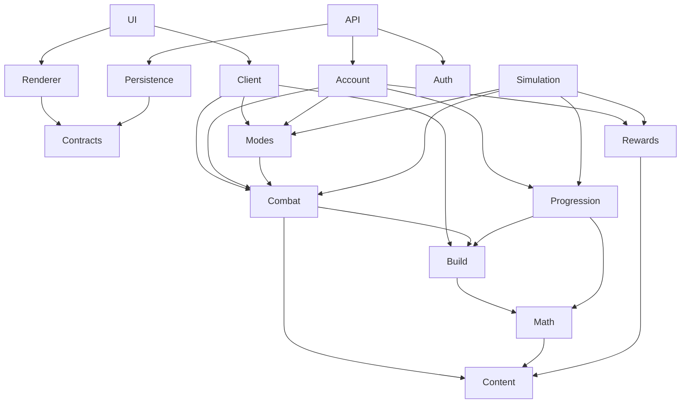

# สถาปัตยกรรมและสัญญาการบันทึก รุ่น Class2-v1

19 ตุลาคม 2026 · TASK-013 · สัญญา M0ที่เลือกใช้จริง; ไม่มีการสร้างremote infrastructureหรือdeployจากงานนี้

## Stack และขอบเขต

ใช้TypeScriptสำหรับpure domain/runner/API, Vite+ReactสำหรับUI และCanvas2D adapterสำหรับACT/STR/ภาพประกอบ เปลี่ยนrendererภายหลังได้โดยไม่เปลี่ยนคำนวณ Supabaseเป็นAuth/ฐานข้อมูลตามที่ผู้ใช้เลือก Vercelใช้Node runtimeพร้อมAPI entryเดียว `api/index.ts` แล้วrouteตามpath แยกlogicออกจากentry รูปแบบนี้รองรับTypeScriptตาม [Vercel Node runtime](https://vercel.com/docs/functions/runtimes/node-js) การpinpackage/Nodeที่รองรับจริงและlockfileเป็นTASK-015 ไม่อ้างว่าติดตั้งแล้ว

Canonical game definitionsคือauthoredJSONที่ระบุในcontentmanifestจาก `plan/data/` Buildเลือกเฉพาะเกม/schema/stringsและสร้างimmutable generatedbundleพร้อมhash ไม่เอาreviewfixtures/ทั้งassetlibraryเข้าเว็บ Game/domainไม่อ่านไฟล์หรือfetchเอง รับvalidated contentผ่านparameter Ajv2020สำหรับruntimevalidatorใช้Draft2020-12ร่วมกับschemas M0 ตาม [Ajv JSON Schema](https://ajv.js.org/json-schema.html) ลงทะเบียนrefsจากlocalbundleเท่านั้น ไม่fetchexternal schemas

[module-contracts.json](../data/module-contracts.json) ระบุpath/import allowlist/publicfunctionsและpuremodules; graphด้านล่างลูกศรแสดงผู้ใช้→dependency:



Combatไม่importModesกลับ Modepolicyเป็นpure typedportที่Modesสร้างแล้วcallerส่งให้Combat; serializeเฉพาะmode_policy_id ไม่serializefunction UI/renderer/networkไม่อยู่ในtransitiveimportsของdomain/runner types DTOอยู่Contracts สแกนimportกราฟ+forbidden globalsจริงในTASK-015/018 ไม่ถือว่าการตรวจJSONgraphพิสูจน์sourcecodeที่ยังไม่มีแล้ว

## Public contracts

```ts
validateContent(raw: unknown, manifest: ContentManifest): Result<ValidatedContent>;
compileBuild(input: BuildInput, content: ValidatedContent): Result<ResolvedBuild>;
createEncounter(mode: ModeInput, content: ValidatedContent): Result<BattleInput>;
createBattle(input: BattleInput, content: ValidatedContent,
             seed: UInt32, modePolicy: PureModePolicy): Result<BattleState>;
advanceUntil(state: BattleState, toGameMs: GameMs,
             content: ValidatedContent, modePolicy: PureModePolicy,
             limits: RunLimits): Result<BattleStep>;
serializeBattle(state: BattleState): BattleCheckpoint;
restoreBattle(raw: unknown, versions: VersionRegistry): Result<BattleState>;
quoteUpgrade(state: AccountState, request: UpgradeRequest,
             content: ValidatedContent): Result<CostQuote>;
calculateFarmClaim(input: FarmInterval, rates: FrozenRateSnapshot,
                   carry: FarmCarry, rng: RngState): Result<FixedRewardClaim>;
rollGacha(state: PityState, count: 1 | 10, rng: RngState,
          pool: ValidatedCardPool): Result<GachaResult>;
decideCommand(save: SaveEnvelope, battle: BattleCheckpoint | null,
              request: Command, context: ServerContext,
              content: ValidatedContent): Result<CommitProposal>;
commitCommand(proposal: CommitProposal): Promise<ReceiptOrConflict>;
runScenario(input: Scenario, content: ValidatedContent): BattleReport;
runMatchedBatch(input: MatchedBatch, content: ValidatedContent): BatchReport;
```

Command/Account/Receiptใช้schemasจริง [command](../data/schemas/command.json), [account-state](../data/schemas/account-state.json), [receipt](../data/schemas/receipt.json) ส่วนstateของengine/runnerใช้ [battle-checkpoint](../data/schemas/battle-checkpoint.json) และ [simulation-scenario](../data/schemas/simulation-scenario.json) Taggedunionsตามtype ไม่รับarbitraryfunctions/refundvectors/ราคาจากclient Resultผิดคืนcode+JSONpointer+definition/commandID; coreคืนdiagnosticไม่เขียนaccountหรือสุ่มนอกcontext

ServerContextประกอบauthenticatedUID, DBserverUTC, requestseed, expectedversions ไม่มีDOM/secretkeyอยู่ในdomain Randomseedจากserveradapter/HMACของUID+requestID+content/cursor สำหรับคำสั่งสุ่ม ผู้ใช้ส่งseedของaccountcommandsเองไม่ได้ Scenario/runnerรับseedexplicitได้ตามปกติ

ResolvedBuildประกอบcharacterID/joblineage/allocatedprimary/paid skill levels/slotinvestment/item-card sources, immutable resolvedSkillprograms และbuildhash BattleActorใช้stableID, owner/source, kind, life_epoch, positions/targetability/terminalflags, resolvedstats/resources และactionpolicy อาจเป็นparty actor, enemy, summon หรือfuturepet ไม่วนแค่สี่actorตามจำนวนNPC

Enemyฐานมาจากencounternumericstats; Summonเก็บprimarysnapshotเจ้าของและderivedsnapshot×.35ตามdefinition, ไม่กินrosterslot, ownerตายลบ Skill/Artifactvariantsทำหลังresolvelevelและก่อนbattleinstanceตามbaseline16 ด้วยstableeffectIDs ไม่แก้sharedbase A/Bactorsแยกsnapshots การเปลี่ยนClass2แยกจากBreakthrough20; Lv70ไม่มีgateพิเศษ Class3/Pet/Rune/Awakenยังไม่เปิดแต่เพิ่มผ่านcontent/build/actorportsเดิมได้

## Battle checkpoint และ deterministic execution

Checkpointมีschema/content/rules/RNGversions+hash, game_time_ms/phase, event_sequence, RNGstate/drawcount, actorsพร้อมbuildsnapshots/HP-SP-spheres/lifeepoch/queuecursor/phase deadlines/pausedNAremaining/casttokens/offensesnapshots, statusinstances/source/expiry/nexttick, shieldpools, summonowner/lifetime, pendingtimerevents, modecontinuation/dailyphaseและmetricsaccumulators

Actorต้องเก็บstat_blueprintของlevel/allocatedprimary/derivedoffsets/permanentmodifier-trigger sourcesและbaseweapon element เพื่อคำนวณใหม่เมื่อstatusเข้า/ออก ไม่เก็บแต่ATKที่บวกbuffแล้ว Active resolved_skillsเก็บlevel+resolveddefinitionของแต่ละท่าเพื่อกู้rotation/variantsได้ ไม่เรียกmaxlevelจากcontentแทนข้อมูลหาย Passivesอยู่permanent_sourcesครั้งเดียวไม่ซ้ำในactiveprograms Castเก็บstarted_at/ends_at/SPก่อนหัก/skill snapshot/locked targetbindings/weapon-element snapshot; status snapshotเก็บweapon elementด้วย

Characterblueprintใช้primaryกับสูตรlevelกลางและoffset0 Enemy/Summonfixedblueprintใช้offset=`desiredDerived−commonFormula(level,primary)` จึงได้authoredbaseเดิมแต่ยังตอบสนองprimarymodifiersด้วยสัมประสิทธิ์กลาง ไม่แยกสูตรbuffอีกชุด Actorstatsเป็นcacheที่recomputeตรวจตรงblueprint+activesourcesได้; sourceถอนแล้วไม่เหลือค่าbuffค้าง Phaseเริ่ม/ระยะเวลา/speedsnapshotและterminal_resultอยู่schemaด้วยเพื่อกู้HUD/ผลจบได้ตรง

Actor.action_policyแยกrotationที่เลือกเปิดNormalAttackจากperiodicprogramของPlantซึ่งเก็บinterval/nexttick/selectors/effects/sourceครบ จึงกู้Plantระหว่างtickได้ SourceRefแยกowner_actor_idสำหรับเครดิตกับorigin_actor_id+origin_life_epochสำหรับผู้สร้างจริง source_actor bindingต้องตรงlifeepochและยังเข้าเกณฑ์ ข้อมูลsnapshotยังอยู่แม้sourceตาย จุดที่tick_on_applyให้ผลทันทีทำในapplyprogram ไม่สร้างeventย้อนกลับไปphaseที่ผ่านแล้ว

หลังterminal/reactionbarrierจึงpruneSummon/ศัตรูที่ตายและrevivable=false พร้อมfuturetimersของมัน; party/actorที่reviveได้เก็บไว้จนจบ MetricของSummonที่หมดอายุรวมไปowner+sourceabilityแล้วถอนper-instance rowเพื่อไม่ให้saveโตตามจำนวนspawn แต่ไม่ทิ้งactivebuffหรือสถานะที่ยังมีอายุ snapshot/sourceIDsของstatusเก็บเครดิตครบโดยไม่ต้องมีdeadSummonทั้งก้อน Actorที่reviveได้เพิ่มlifeepoch/reattachpermanentsourcesและไม่รับeventเก่าข้ามชีวิต

Eventheapเรียง `(game_ms,phase,sequence,actor_id,action_id)` IDsเปรียบเทียบcodepointแบบคงที่ ไม่ใช้localeCompare ลำดับphaseตามbaseline15 RNGlcg32-v1/Math.imul/uint32และdrawpolicyเดียวกันในbrowser/Node ทุกrawpower/mitigation/roundingเรียกmathกลาง Formulaไม่เขียนHP; handlerคืนtyped intentsเท่านั้น Mappingแนวคิดrestore_fieldsกับJSONpathsจริงอยู่ในcombat-rules.simulation_contract.checkpoint_field_mapping Resource-regenมีtimerของตัวเองที่phaseperiodic ไม่หายเพราะกำลังCT/ติดCC

Metricsมีteam/actor/skillrowsตามschema พร้อมdamage/heal/overheal/shield/SPspent-restored-wasted-skips/casts/interrupts/phase times แยกCCblocked_actor_msที่unionช่วงหยุดของเป้าจากCCinstance_msที่รวมเวลาแต่ละแหล่งซ้อนกันได้ จึงไม่รายงานเวลาซ้อนเป็นpercentCCเกิน100% [simulation-contracts](../data/simulation-contracts.json) กำหนดgearprofilesและA/Bใช้seeds/encountersเดียวกัน ตรวจactualspentbudget/allocatedpoints/gear/skilllevels หากไม่เท่าคืนBUDGET_MISMATCH ไม่เพิ่มAGI/DEXหรือfree skilllevelsให้พอดีเงียบ ๆ

advanceUntilส่งstateกลับเฉพาะหลังtimestamp/reactionbarrierครบ ไม่มีcheckpointกลางeffectprogram/lockedcompletionbatch การใช้budgetหมดกลางtimestampคืนdiagnosticพร้อมlastgoodbarrier ไม่commitpartialrewards จึงไม่ต้องserializecallbackstack Snapshotrestoreที่versionsตรงต้องได้hash/metricsตรงuninterruptedrunในTASK-018/044 ไม่เพิ่มผลจากRAF/audio

advanceUntilรักษาinputcheckpointไว้และทำงานบนowned mutable working stateหนึ่งก้อนต่อcall โดยshareเฉพาะdefinitions/buildsnapshotsที่freezeแล้ว เมื่อสำเร็จจึงคืนstateใหม่; ถ้าผิดพลาดทิ้งproposalทั้งcallแล้วใช้inputbarrierที่commitไว้เดิม ไม่แก้ข้อมูลของA/Bอีกตัว Browserอาจadvance20ครั้งต่อวินาทีและวาดinterpolation30/60FPS ส่วนrunnerเดินเหตุการณ์ถึง90sในcallเดียวได้ จึงไม่deepcloneทั้งdefinitionทุกeventหรือผูกdamageกับframe การบังคับimmutability/ความเร็วต้องมีผลรันTASK-015/018

Battle checkpointเป็นserver-ownedpayloadในtableของมันเอง AccountState.active_battleเก็บpointer/lease/modeเท่านั้น ไม่เก็บHPหรือRNGอีกสำเนาในwallet save Localpredictedbattleอ่านล่าสุดและวาดต่อได้จนpendinglimit แต่ไม่มีสิทธิ์มอบwin/rewardจนserverreceiptมา

## Authority และฐานข้อมูล

[save-contracts.json](../data/save-contracts.json) ระบุauthority/tablecolumns/compatibility/interruptionและenvironmentnames:

| ข้อมูล | Source of truth | สำเนาอื่น |
| --- | --- | --- |
| wallet/inventory/roster/slotinvestment/clears/claims/paidledger | game_saves.state JSONBหนึ่งก้อนต่อAuthUID | UI/localbackupอ่านrevisionที่อ้างเท่านั้น |
| revision/schema/content/rules/statehash | columnsของgame_saves | responseอธิบายสำเนา ไม่มีคอลัมน์walletแยกอีกชุด |
| battleHP/clock/RNG/status/events | game_battle_checkpoints.payload | browserpredictedอาจถูกแทนด้วยcheckpoint |
| commandresult/idempotency | game_command_receipts `(account_id,request_id)` | เดิมอ่านซ้ำได้ ไม่คำนวณราคา/สุ่มใหม่ |
| backup/recoveryhistory | game_save_history | blobจากเครื่องต้องตรวจsignature/account/historytip |
| draft/preferences | browserlocal | ไม่รวมwalletและไม่mergeเป็นcloudstate |

game_savesใช้account_idFKauth.users/PK, revisionbigint, schema_versionint/content_version/rules_version/state_hash/updated_atและstateJSONB; tablebattle/receipt/historycolumnsและPKอยู่JSON Receiptsเก็บID/hash/resultถาวรไม่เก็บsaveทั้งก้อนทุกคำสั่ง Historyเก็บล่าสุด20revisionและdailytip7วันเพื่อตรวจrestore Logsไม่เก็บpassword/access token/serversecrets

Accountschemaเก็บเจ็ดcharactersแม้นอกทีม หกslotต่อcharacter, inventory equipment/card instancesแยกkind, manualprimary+unspent/level/cap/gates/skills/rotation, partypositions, story/farm/tower/daily/pity/pendingclaims/ledgerครบ Derivedcombatstatsเป็นbuildoutput ไม่เขียนเก็บถาวรซ้ำ ทุกresourcevectorขยายแปดสกุลจากregistryด้วยdefault0 การอยู่ในinventoryนับรวมของสวมและการ์ด; assignmentอยู่ที่characterเท่านั้น ไม่มีequippedflagอีกตัวในitemให้ขัดกัน

Semanticvalidationเพิ่มจากJSONSchema: IDsไม่ซ้ำ, mainหนึ่ง/NPCหกrootfixed, jobสืบจากroot, teammain+NPC3ไม่ซ้ำroot/ตำแหน่ง, skillunlock/cap/สี่ท่าไม่ซ้ำ/copygroupสูงสุดหนึ่ง, item/cardinstanceถูกassignครั้งเดียวและชนิด/slot/weaponตรง, cardcapacityตามRefine, แต้มใช้ไม่เกินearned, walletเป็นsafeintegersไม่ติดลบ Invalidsnapshotไม่ถูกแทนด้วยemptywalletเพื่อให้เล่นต่อ

## Command และ atomic receipt

UIมีdurableactions34ตัวจาก [ui-flows.json](../data/ui-flows.json) Commandschemaแยกtypedparamsครบทุกtype ไม่รับaccount_idในpayload ใช้UIDจากJWTเท่านั้น GET`/api/account`, GET`/api/receipts/:id`, POST`/api/commands`, GET`/api/health` ใช้localAPIกับisolatedSupabaseได้ก่อนpublicPreview

CanonicalrequesthashคือSHA256ของtype/params/expectedrevision/schema/content/rulesและcontent_hash โดยsortobjectkeysตามASCII, arraysคงลำดับ, JSONnumbersเป็นfinite safeintegers, ไม่trim/normalizeIDsตามlocale RequestIDคือUUIDและscopeต่อบัญชี ตัวอย่างexpectedrevision5กับคำสั่งสำเร็จเป็นrevision6:

ทุกnewcommandต้องส่งexact runtime content_hash ไม่ตรวจแค่versionชื่อที่คนอาจลืมbump Runtimehashรวมengine-data projection+game schemas+implementation sourcehash; ภาพ/เสียงมีhashแยก หากclientแสดงราคาเก่าแล้วhashไม่ตรงให้UPDATE_REQUIREDก่อนจ่าย ไม่คิดราคาใหม่โดยผู้เล่นไม่เห็น Saveenvelope/activebattle/receiptระบุhashนั้น; receiptเดิมอ่าน/retryก่อนcurrenthashadmissionจึงยังรับผลคำสั่งเก่าได้ M0manifestยังไม่มีimplementationhash ไม่ใช้แทนruntimehashตอนpublish

1. Authenticate+lookupreceiptก่อนversion/revision ถ้าIDเดิม/hashเดิมคืนreceiptต้นฉบับ แม้saveตอนนี้revision20หรือclientเก่าแล้ว
2. IDเดิม/hashต่างคืน409IDEMPOTENCY_KEY_REUSE ไม่ทำคำสั่งใหม่ NewID/expectedrevision5แต่current6คืน409REVISION_CONFLICT ให้โหลดcloudแล้วออกintentใหม่เมื่อผู้เล่นยังต้องการทำ
3. อ่านsave/checkpointและDBserverUTC สร้างpure proposalด้วยsharedrules ราคาจากcontentเท่านั้น ไม่มีwalletdeltaจากclient
4. RPCservice-only lockaccountrow แล้วlookupreceiptซ้ำ/checkrevisionCAS เพื่อตัดrace ถ้าตรงให้commit save revision+1, checkpoint, reservedclaims, paidledger, receiptและhistoryในtransactionเดียว SQLไม่คำนวณlevelcost/AFK/odds/refundอีกชุด
5. responseหายส่งrequestID/paramsเดิมได้ Receiptresultไม่ถูกapplyเป็นdeltaซ้ำถ้าlocalrevisionข้ามไปแล้ว ให้fetchlateststate Responseใหม่อาจมีauthoritativeviewคู่receiptเพื่อประหยัดGET แต่ไม่เก็บfullviewในreceiptทุกครั้ง

Businessrejection เช่นเงินไม่พอเก็บrejectedreceiptไว้แต่ไม่เพิ่มaccountrevision ไม่ให้เติมเงินแล้วretryIDเดิมกลายเป็นการซื้อที่ผู้เล่นไม่ได้ยืนยันอีก Conflict/auth/schemafailureไม่มีbusinessmutation Accountcreateexpectedrevision0ใช้accountlock/uniqueUIDสร้างstate+startergrantครั้งเดียว requestที่แข่งกันไม่แจกgrantซ้ำ

ทุกbuild/gear/slotคำสั่งต้องอยู่นอกactivebossbattle ส่วนbattleadvance/retreatรับเฉพาะbattleIDที่pointer/owner/leaseตรง Gacha10pull/cost/pity/สิบinstancesและreceiptcommitก้อนเดียว ถ้าพื้นที่ไม่พอปฏิเสธก่อนหักcrystalและไม่เปิดผลให้rerollด้วยIDใหม่

## AFK, pending rewards และ reconnect

DBserverUTCเป็นclockauthorityเดียว Clockเครื่องผู้เล่นไม่กำหนดclaimday/AFK/dailyattempts Purefarmรับelapsed_ms+numeric frozenrates/carry/RNGแล้วคืนfixedclaim ไม่เดินcombatย้อนหลัง ฟาร์มทำงานต่อระหว่างท้าบอสแต่ไม่รับเงินจากvisualkillsเพิ่ม

แยก **reservation cursor** กับ **จ่ายแล้ว**: reserveช่วงที่ยังไม่เคยreserveสูงสุดล่าสุด12hเป็นpendingclaimพร้อมfixedresource/items/RNG/carry แล้วขยับreserved_throughแบบatomic การรับclaimค่อยเพิ่มwallet+itemsและลบpendingในอีกtransactionหนึ่ง/หรือทำในtransactionเดียวกันทันทีถ้าพื้นที่พอ Responseเต็มinventoryยังเก็บclaimเดิม ไม่มีการสุ่มใหม่หรือรับเงินบางส่วนจนลืมgear Reservedแต่ยังไม่จ่ายถือเป็นยอดpendingที่รับได้ ไม่ถูกregenerateเป็นclaimถัดไป

stagechange reserveintervalเก่าด้วยratesnapshotเก่าก่อนเปลี่ยนและคงpendingเดิมไว้ Patchยังใช้storednumericrate/dropweights/definitionpoolจนจบreservationนั้นก่อนรับrateใหม่ ถ้าไป20hเก็บ12hล่าสุด/ทิ้งส่วนเกินครั้งเดียวและcursorถึงnow มีpendingได้32bundles; ถ้าเต็มหยุดnewreservation/newbattleก่อนmutation แต่salvage/fusion/claimยังทำได้จนว่าง

เมื่อnetขาดclientพักการสร้างdurableprogress เก็บsignedservercheckpointล่าสุดและpendingrequestID ไม่ส่งautosavewalletทั้งก้อนทับcloud Reconnect lookupreceiptที่ค้าง→โหลดcloudlatest→ตรวจversions/lease→เริ่มattemptใหม่ตามmodepolicy การจัดทีมdraftที่ยังไม่commitอาจให้ผู้เล่นreviewใหม่ได้ แต่เงิน/ของ/claimsไม่merge

## Online battle และ interruption

Clientส่งadvanceทุกประมาณ2000ms Serverrestorecheckpointแล้วจำลองได้ไม่เกินmin(requestdelta,เวลาจริงตั้งแต่ack,5000ms) ถ้าเวลาDBถึงlease15000msหรือเกินให้abort ไม่จำลองช่องว่างนั้นย้อนหลัง ต่อให้requested_game_msกระโดดไป90000ก็ไม่ชนะในwalltime0 ถ้าDBclockถอยคืนCLOCK_REGRESSIONไม่เพิ่มเวลา

สัญญาrefresh/ปิดแท็บ/visibilityhiddenเลือกabortactivebossmodeและให้farmทำงาน; ไม่resumeการตีบอสระหว่างปิดเกม โดยเฉพาะdailyไม่คืนattempt ถ้าคำสั่งretreatส่งไม่ถึงserverก็ไม่มีadvanceใหม่ หลังleaseหมดabortจากlastcheckpointเมื่อกลับมา Ticketwallmaximum180sเป็นขอบเขตoperation ไม่ใช่เวลาตีบอสที่เพิ่มจาก60/90s

| Mode | Durableเมื่อหยุด | Transientที่ล้าง/เมื่อกลับ |
| --- | --- | --- |
| Story | clear/pendingrewardที่servercommitแล้ว | HP/SP/buffs/casts/events; retryฟรี/เต็มทีม |
| Tower | highestfirstclear/pendingreward | restartfloorถัดไปฟรี ไม่resetfloor |
| Daily | attemptspent/lastcommittedphase-HP/reservedchestsของticketday | ล้างทีม/clock; attemptใหม่เต็มHP/SPแต่bossHPเดิม |
| Farm | rate/carry/lootRNG/reservationcursor/pending | visualkillไม่เกี่ยว settlementตามunreservedinterval12h |

Dailyแต่ละphaseclearตรวจmodecontinuationก่อนordinaryterminalcheck เพิ่มphaseโดยไม่resetpartyclock/สถานะ และreservechestkeysครั้งเดียว รวมchestsของticketเป็นหนึ่งpendingbundle ถ้าเริ่มวัน19จบวัน20เขียนเฉพาะticketday19 Newdayrecordsเริ่มphase1/attempts0 ไม่มีdailyofflinebossdamage เก็บcurrent+previousdayrecordsและpendingclaimkeysแยก; ticketเก่าเกิน180sไม่เขียนHPใหม่

## Version, migration, ledger และ backup

Current schema1/contentclass2-v1.0.0/rulescombat-baseline-v1/RNGlcg32-v1พร้อมsourcehashmanifest การเปลี่ยนราคา/สูตรเปลี่ยนcontent/rulesตามหน้าที่ ห้ามใช้latestcontentแทนเวอร์ชันของreplayโดยเงียบ ๆ Asset-onlypatchไม่เปลี่ยนenginehash

| กรณี | ผล |
| --- | --- |
| ทุกversionตรง | restoreที่barrierแล้วได้ผลเดิม |
| contentใหม่/เปลี่ยนbalance | abortactivebattleตามmodepolicy, ใช้farmratesnapshotเก่าจนreservation, recompilebuildรอบใหม่ |
| rules/RNGเปลี่ยน | replayแจ้งincompatibleหรือใช้archivebundleรุ่นเดิม, activebattleabort |
| schemaเก่าที่รองรับ | orderedatomicmigrationพร้อมaliases/ledger/receiptก่อนเล่น |
| schemaใหม่กว่าclient | read-only/UPDATE_REQUIRED |
| IDถูกrename/delete | ต้องมีmap/retainedlegacydefinitionหรือexplicitpaidrefund/compensationcaseก่อนpublish ไม่มีunknownrefsปล่อยผ่าน |

paidledgerเก็บentryID/character/feature/skill/quantity/cost_version/paidvector/refundstate/commandID อัปด้วยราคา100แล้วแพตช์ราคา150 คืน100เท่านั้น ถ้าwalletก่อนคืน200จะเป็น300; retryคืนเดิมยัง300 Grantคืน0 Resetถอนpaid skilllevelsและคืนแต้มไปตัวเดิม ไม่เก็บpresetที่ซื้อคืนได้ฟรี Gear/slotinvestmentsไม่refundตามrespecของskill

เพื่อไม่ให้respecสะสมledgerจนsaveโตไม่สิ้นสุด เก็บactiveinvestmentหนึ่งentryต่อcharacter+feature+skillโดยรวมactualpaidvectorsและcost_versionsที่เคยใช้; cost_versionเดี่ยวชี้contributionล่าสุด เมื่อrefundให้ถอนentryactiveและเก็บfullrefundedentry/commandIDในimmutable receiptที่อยู่นอกaccountJSON ครั้งถัดไปไม่มีactiveentryจึงคืน0 แม้ใช้requestใหม่ Currentsevencharactersมีactive scopesสูงสุด136สำหรับskills/enchant ไม่เก็บhistoryทุกครั้งในsave Level/Refine/Cardที่ไม่มีrefundตามรุ่นแรกเก็บหลักฐานค่าใช้จ่ายในreceiptแทน

schema/code rollbackไม่เขียนDBsnapshotเก่าทับreceiptที่commitใหม่ ใช้expand/contractmigrationและdeploycodeที่อ่านschemaใหม่ได้ ถ้าถอยไม่ได้ให้maintenance/read-onlyแทนย้อนเงิน Snapshotbackupเป็นsame-account signedserverhistorytipและhash/keyversion ไม่มีcredentials Localblobrev4ห้ามทับcloudrev8; ใช้อ่าน/exportหรือserverrecoverจากhistoryที่ตรวจแล้วเท่านั้น Restorecommandใช้เมื่อsavequarantined/corruptและต้องได้latestverifiedtip ไม่ใช่อัปโหลดwalletที่แก้เอง

## Auth, RLS และ environment

Email/passwordใช้signUp/signInWithPasswordและpassword-resetcallbackตาม [Supabase password auth](https://supabase.com/docs/guides/auth/passwords) มีverify-email/recoveryflow; localtestใช้CLI/Mailpitตาม [Supabase local development](https://supabase.com/docs/guides/local-development) Hostต้องทดสอบmailflowจริงของบัญชีส่วนตัวตอนTASK-021 ไม่ถือว่าออกแบบหน้านี้แล้วส่งอีเมลได้

ทุกtableenableRLS/grantsในmigrationเดียว anonymousไม่อ่านsave, authenticatedSELECTเฉพาะ`account_id=auth.uid()`และไม่มีINSERT/UPDATE/DELETE/commitRPCตรง browser Serverservicekeyอยู่serverและAPIต้องbindUIDเองเพราะservice roleข้ามRLSได้ตาม [Supabase RLS](https://supabase.com/docs/guides/database/postgres/row-level-security) TASK-021ต้องทดสอบสองบัญชี+anonymousทั้งallow/denyจริง

BrowserenvมีSUPABASEURL/publishablekey/appenv ส่วนservicekey/signingkeyเป็นserveronlyตามsave-contracts ไม่มีsecretในrepo/backup/buildlogs Local/Previewใช้isolatedtestdatabase+separatecallbackURLs ไม่ชี้productionsave เปิดAPIผ่านlocalhostได้ก่อนpublicPreview

## Quality budgets และหลักฐานต่อไป

[quality-budgets.json](../data/quality-budgets.json) ระบุอุปกรณ์จากprogressionprofiles, network10Mbps/RTT100ms, coldcache, bytes/frame/memory/runner/APIเกณฑ์ตัวเลขพร้อมวิธีวัด ตัวอย่างfirstbattle8MiB/desktop10s/mobile15s, framep95desktop20ms/mobile35ms, headless100×90sภายใน5s, packet/stateขนาดจำกัดเพื่อส่งบนAPIได้ ต้องวัดจริงในTASK-018/019/022/042ไม่อ้างผลผ่านตอนM0

Stressscene16actors/40statusinstancesต่อตัวและVFX16เป็นscenarioวัด ไม่ใช่capการเล่น UIอาจรวมicon/ลดparticlesแต่engineยังนับครบ ไม่มีการทิ้งbuffเพื่อรักษาFPS LocalAPI+mockrepositoryทำreceipt/revisionfixturesในTASK-015ก่อน DockerRLS/transaction tests TASK-021/022; sharedrunner/replay TASK-018, refund/migrate/restore TASK-040/044 การclosureA-01–A-08เป็นระดับdesignเท่านั้นจนหลักฐานเหล่านี้มีจริง

ข้อแก้จากรอบตรวจรวม: farmสะสมด้วยmilliseconds/ตัวหาร3,600,000และdropcarrymilliseconds เพื่อเก็บเศษรับถี่/เปลี่ยนrateไม่ให้หาย เมื่อreserved cursorขยับถึงservernow ห้ามfloorทิ้งเศษวินาที ใช้integer-safe intermediateตามbaseline15 และไม่ส่งfloatcurrencyเข้าwallet

Implementation finding TASK-017 (19 Oct 2026): `battle-checkpoint.trigger_activations` serializes per-battle proc limits by source instance/trigger. Root-action counters are discarded after the complete reaction barrier. A `battle_start` timer runs entry reactions once, including after restoring the initial barrier. These fields extend the unpublished schema1 contract; content/schema hashes change, so older snapshots are explicitly incompatible rather than silently resetting proc limits.

20ตุลาคม2026 TASK-023: client เพิ่ม import progression เพื่อ preview ราคา/แต้มและ sandbox ด้วยpure rulesจริง UI ยังเรียกclientเท่านั้น `src/domain/progression/characters.ts` เป็นเจ้าของquote/reducer และ `initialize.ts` เป็นfactoryร่วมaccount/client ไม่มีaccountcommitหรือserverเข้าฝั่งUI/simulation
